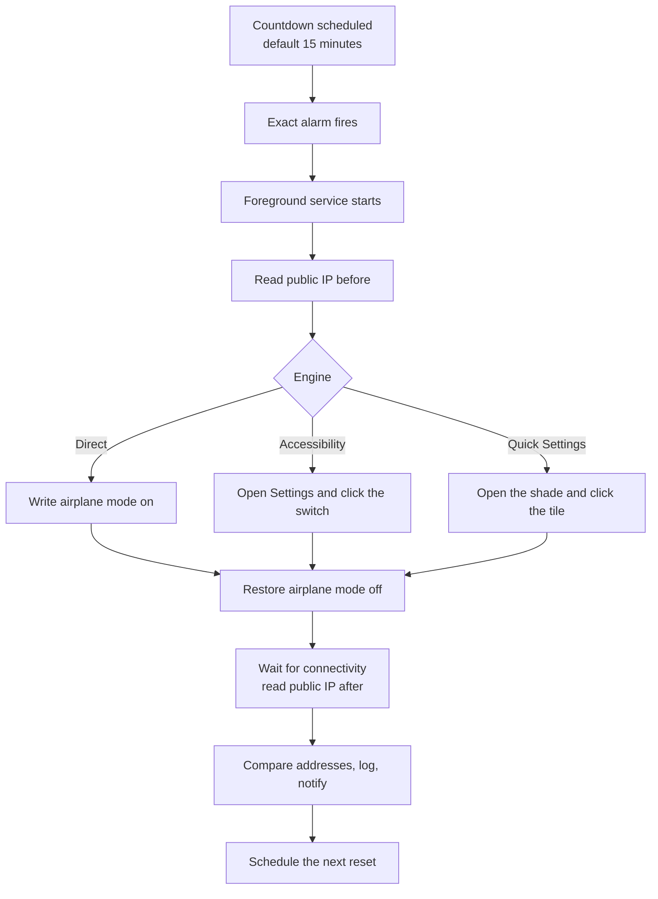

# T9 APK Tools

A no-root Android utility that automates the airplane-mode toggle used to make
a Jio hotspot session request a new public IP.

[](https://github.com/engrtarun/t9-apk-tools/actions/workflows/android.yml)
[](https://engrtarun.github.io/t9-apk-tools/)
[](https://github.com/engrtarun/t9-apk-tools/releases/latest)
[](LICENSE)

- Package: `dev.t9.apktools`
- Android 8.0+ (minSdk 26), target and compile SDK 34
- Native Java 17, no root, no Play Store listing
- Download: [APK](https://engrtarun.github.io/t9-apk-tools/download/t9-apk-tools.apk) and [version.json](https://engrtarun.github.io/t9-apk-tools/download/version.json)
- Releases: [latest APK](https://github.com/engrtarun/t9-apk-tools/releases/latest) · [all releases](https://github.com/engrtarun/t9-apk-tools/releases)

## What it is

T9 APK Tools is a small sideloaded app that runs a countdown, briefly turns
Airplane mode on and off when the countdown ends, and checks whether the public
IP address changed. It is built for the specific routine of keeping a Jio
hotspot session fresh without sitting next to the phone and doing it by hand.

It is not a VPN, a proxy, or an IP rotator with a pool of addresses. It only
automates a toggle the user could perform manually.

## The real problem

Jio, like many mobile carriers, places subscribers behind carrier-grade NAT
(CGNAT). The public IPv4 address a website sees is shared and assigned by the
carrier, not by the phone. A hotspot session can keep the same mapping for a
long time, even after the phone reconnects.

Some legitimate work needs a fresh mapping: testing how a service behaves from
a different network path, clearing a stuck session, or reproducing a
network-dependent issue. The usual workaround is:

1. Turn Airplane mode on.
2. Wait for the radios to drop.
3. Turn Airplane mode off.
4. Wait for mobile data to reconnect.
5. Turn the Wi-Fi hotspot back on.
6. Repeat every 15 minutes.

That is tedious, easy to forget, and hard to do while the phone is charging in
another room. T9 APK Tools automates the timing and the toggle, then tells you
whether the IP actually changed.

A new IP is never guaranteed. The carrier decides whether a reconnect receives
a different address. See [Limitations](#limitations) and
[docs/HOW-IT-WORKS.md](docs/HOW-IT-WORKS.md).

## What it does

- Runs a countdown, 15 minutes by default, and schedules an exact alarm for the
  end of it.
- Starts a foreground service so the reset is visible and less likely to be
  killed while it runs.
- Toggles Airplane mode through one of three engines: Direct, Accessibility, or
  Quick Settings. Auto mode picks the best available engine.
- Reads the public IP before and after the toggle using api.ipify.org, with
  icanhazip.com and ifconfig.me as fallbacks.
- Restores Airplane mode to the state it found, usually off, including when the
  toggle or IP check fails.
- Re-arms the timer after a reboot.
- Keeps local history in SQLite: the newest 120 log events on screen, 150 runs
  in History, and 80 IP readings on the card, with clear actions.
- Opens History from **ALL RESETS**: every run with before → after, engine,
  duration, filters, share and clear, plus expandable log lines.
- Recovers from a failed launch: a readable crash trace is saved and shown on
  the next start with a **Copy log** button.
- Optionally tries to re-enable the Wi-Fi hotspot after the reset. This is
  experimental.
- Shows a notification with the countdown and the result.

## The three engines

| Engine | Requirement | Reliability | Screen state |
| --- | --- | --- | --- |
| Direct | One-time ADB grant of `android.permission.WRITE_SECURE_SETTINGS` | Highest. Writes the system setting directly. | Screen can be off or locked; some OEMs may still block the write. |
| Accessibility | Accessibility service enabled for T9 APK Tools | High, but OEM-dependent. Opens the Airplane mode Settings page and clicks the switch. | Device must be unlocked and the screen on. |
| Quick Settings | Accessibility service enabled for T9 APK Tools | Medium to high. Opens the Quick Settings shade and clicks the Airplane tile. Falls back to calibrated screen coordinates. | Device must be unlocked and the screen on. |
| Auto | Direct grant, or accessibility service, or both | Uses the most reliable engine available: Direct, then Accessibility with Quick Settings before the Settings page. | Depends on the chosen engine. |

The Direct engine is the only one that can work with the screen off. It needs a
PC once, unless you use Android's wireless debugging. The other engines need no
PC but need an unlocked phone at reset time.

## How a reset runs

1. You start a countdown. The app stores the end time and schedules an exact
   alarm.
2. The alarm fires and the app starts its foreground service.
3. The service reads the current public IP.
4. The selected engine turns Airplane mode on: it writes the secure setting,
   clicks the Settings switch, or clicks the Quick Settings tile.
5. After a short pause, the app turns Airplane mode off and waits for
   connectivity.
6. It reads the public IP again, compares it with the first reading, and writes
   the result to the local log.
7. It optionally tries to restore the hotspot, then schedules the next reset if
   the timer is still active.



The full sequence, including failure handling, is in
[docs/HOW-IT-WORKS.md](docs/HOW-IT-WORKS.md).

## Install

T9 APK Tools is distributed as a sideloaded APK. It is not on the Play Store.

### From GitHub Pages

1. Open [the download page](https://engrtarun.github.io/t9-apk-tools/) or the
   direct [APK link](https://engrtarun.github.io/t9-apk-tools/download/t9-apk-tools.apk).
2. If prompted, allow your browser or file manager to install unknown apps.
3. Open the downloaded APK and install it.
4. If Play Protect shows a warning for an app it does not recognize, review it
   and continue only if you trust the source.

The Pages directory also publishes
[version.json](https://engrtarun.github.io/t9-apk-tools/download/version.json)
with the version, version code, size, SHA-256, signer SHA-256, build time,
commit, and workflow run. It is generated by CI from the APK in the same build;
it is not committed. The page reflects the last `main` build, while the tagged
release is the stable install. Compare the SHA-256 if you want to verify a
download.

### From GitHub Releases

Tagged builds are attached to
[GitHub Releases](https://github.com/engrtarun/t9-apk-tools/releases). Download
`t9-apk-tools.apk` from the release for the version you want.

Builds from this repository are signed with the project's public community key.
That lets later builds update earlier installs without uninstalling. The
trade-off is documented in [SECURITY.md](SECURITY.md). If you install a build
signed with a different key, Android will refuse the update until you uninstall
the old app, which deletes its settings and logs.

## One-time setup

Complete these steps after installing. The detailed version, including
troubleshooting, is in [docs/SETUP.md](docs/SETUP.md).

1. **Notifications.** Allow notifications on Android 13 and later. The
   countdown and reset result use a notification.
2. **Exact alarms.** On Android 12 and later, allow Alarms and reminders for T9
   APK Tools. Without it, the timer can be delayed.
3. **Battery optimization.** Set the app to Unrestricted, or the equivalent on
   your OEM, so the alarm and foreground service are not killed.
4. **Accessibility service.** Enable T9 APK Tools in Settings > Accessibility if
   you want the Accessibility or Quick Settings engine. This is optional if you
   use Direct.
5. **ADB grant (optional, for Direct).** Connect the phone to a computer with
   USB debugging enabled and run the grant command from
   [docs/SETUP.md](docs/SETUP.md). The grant survives reboots and app updates,
   but is lost if you uninstall the app.

Auto mode uses Direct when the grant exists and falls back to Accessibility
otherwise. You can also choose an engine explicitly.

## Usage

1. Open T9 APK Tools.
2. Set the countdown. The default is 15 minutes.
3. Choose Auto, Direct, Accessibility, or Quick Settings.
4. Start the timer. The notification shows the remaining time.
5. Leave the phone unlocked if you selected an accessibility-based engine.
6. When the timer ends, the app toggles Airplane mode, restores it, checks the
   IP, and logs the result.
7. Read the **ACTIVITY** panel for the newest events. Tap **ALL RESETS** for
   History: every run with before → after, engine, duration, filters
   (new/same/failed), share and clear, plus expandable log lines.

If the hotspot is enabled before the reset, Airplane mode will turn it off. The
optional hotspot restore is experimental; see [Limitations](#limitations).

Quick Settings calibration: if the tile cannot be found by text on your OEM
skin, set the tile position as a percentage of the screen with the X/Y sliders
in **SETUP**. This build has no tap-to-calibrate. The stored position is used
only as a fallback when node matching fails.

## Build via GitHub Actions

No local Android SDK is required. The repository builds on GitHub Actions with
[`.github/workflows/android.yml`](.github/workflows/android.yml).

The workflow runs on:

- A push to `main`.
- A tag matching `v*`, for example `v1.0.0`.
- Manual dispatch from the Actions tab.

It uses Ubuntu, Temurin Java 17, Gradle 8.8, and the Android SDK. It decodes
`keystore/t9-release.jks.b64`, builds `:app:assembleRelease`, verifies the APK
with `apksigner`, writes `site/download/version.json`, uploads the APK as the
`t9-apk-tools-apk` artifact, and uploads `site` as the Pages artifact.

- Pushes to `main` deploy the Pages artifact.
- Tags starting with `v` create a GitHub Release with the APK attached.
- Every successful build keeps the APK artifact for 30 days.

Versioning:

- `versionName` comes from the root [`VERSION`](VERSION) file.
- `versionCode` comes from `GITHUB_RUN_NUMBER`.
- A tag such as `v1.0.0` should match the contents of `VERSION`. The workflow
  builds from the tag, not from the tag name.

Release signing reads exactly these environment variables:

| Variable | Value in the workflow |
| --- | --- |
| `T9_KEYSTORE_PATH` | `${{ runner.temp }}/t9-release.jks` |
| `T9_KEYSTORE_PASSWORD` | `t9-apk-tools` |
| `T9_KEY_ALIAS` | `t9` |
| `T9_KEY_PASSWORD` | `t9-apk-tools` |

The keystore is public by design. Read [SECURITY.md](SECURITY.md) before
replacing it or reusing it for anything else.

### Optional local build

If you want to build locally, install JDK 17, Android SDK 34, and Gradle 8.8.
There is no Gradle wrapper in the repository. From the repository root:

```bash
gradle :app:assembleRelease --no-daemon
```

Set the four signing variables first. The release APK is written to
`app/build/outputs/apk/release/app-release.apk`. The project's supported path is
still Actions, because it is the one that also verifies the signature and
publishes the metadata.

## Why native Java instead of React Native

The core of this app is an Android `AccessibilityService`. It is a
system-bound service with a manifest declaration, a lifecycle controlled by
Android, and direct access to `AccessibilityNodeInfo` trees. JavaScript cannot
implement it. React Native would need a native Android service and a native
module anyway, plus a bridge, a larger runtime, and more moving parts for a UI
that is a timer, a few switches, and a log list.

A React Native build would add tens of megabytes to the APK (roughly 50 MB in
typical release setups) and still need the same Java service for node matching,
gestures, secure settings, exact alarms, and the foreground service. Native Java
keeps the APK small, makes the permission and service behavior explicit, and
avoids a second toolchain for no user-visible benefit.

## Project structure

```text
.
├── .github/
│   ├── workflows/android.yml       Build, verify, Pages, and release pipeline
│   ├── ISSUE_TEMPLATE/bug_report.yml
│   └── pull_request_template.md
├── app/                            Android app module (Java)
│   ├── build.gradle
│   └── src/main/
│       ├── AndroidManifest.xml
│       ├── java/dev/t9/apktools/   Activities, services, receivers, utilities
│       └── res/                    Layouts, drawables, strings, accessibility config
├── art/                            Project artwork
├── docs/
│   ├── HOW-IT-WORKS.md             Android behavior, engines, failure modes
│   ├── SETUP.md                    Install, permissions, ADB, troubleshooting
│   ├── TROUBLESHOOTING.md          Symptom-to-fix guide
│   ├── UI-RESEARCH.md              UI decisions and references
│   ├── SKILLS.md                   Engineering methods and evidence
│   └── PRIVACY.md                  Data handling and permissions
├── keystore/
│   └── t9-release.jks.b64          Public community signing key
├── site/                           Static GitHub Pages payload
│   └── download/                   Generated APK and version.json in CI
├── build.gradle                    Root build configuration (AGP 8.2.1)
├── settings.gradle
├── gradle.properties
├── VERSION                         Release version name
├── CHANGELOG.md
├── SECURITY.md
├── CONTRIBUTING.md
├── LICENSE
└── README.md
```

There is no `gradlew` or `gradle/wrapper` directory. CI installs Gradle 8.8
through `gradle/actions/setup-gradle`.

## Limitations

- **A new public IP is not guaranteed.** Jio uses CGNAT, and the carrier
  controls address assignment. The app can prove that it toggled Airplane mode;
  it cannot force a different public address. A reset may return the same IP.
- **The hotspot may drop.** Airplane mode turns off Wi-Fi and the hotspot. The
  optional hotspot restore is experimental, OEM-dependent, and cannot guarantee
  that connected clients reconnect cleanly.
- **UI automation needs an unlocked screen.** Accessibility and Quick Settings
  engines cannot operate on a locked device. The Direct engine can, subject to
  OEM restrictions.
- **OEM behavior varies.** Settings labels, Quick Settings layouts, and
  background restrictions differ across Samsung, Xiaomi, Oppo, Vivo, OnePlus,
  Realme, and others. Node matching has fallbacks, but not every skin is
  covered.
- **Android restricts background work.** Exact alarms need user approval on
  Android 12 and later, foreground services show a notification, and some OEMs
  kill background apps aggressively even with battery optimization disabled.
- **Sideload restrictions.** Android 13 and later may block accessibility or
  notification access for sideloaded apps until you allow restricted settings
  in the app's info screen.
- **IP checks depend on third parties.** api.ipify.org, icanhazip.com, and
  ifconfig.me can be slow, blocked, or unreachable. A failed check makes the
  result inconclusive, not necessarily a failed toggle.
- **VPNs and IPv6 change the picture.** A VPN hides the carrier address. IPv6
  and IPv4 can differ. Turn off VPNs when testing whether the carrier address
  changed.
- **No root and no Play Store.** The app uses documented Android APIs and one
  optional ADB grant. It does not root the device or bypass carrier controls.

## Privacy and security

T9 APK Tools has no accounts, analytics, ads, or crash reporting. Its only
network calls are to the three public-IP endpoints. Logs stay on the device,
limited to the last 120 entries, and can be cleared from the app. Accessibility
window data is inspected on-device only while a reset runs and is never stored
or transmitted.

Read [docs/PRIVACY.md](docs/PRIVACY.md) for the full data-handling note and
[SECURITY.md](SECURITY.md) for the signing-key caveat and private vulnerability
reporting.

## FAQ

**Does it need root?**
No. The Direct engine needs a one-time ADB grant of
`WRITE_SECURE_SETTINGS`. That is a development permission grant, not root.

**Will I get a new public IP every time?**
No. The app automates the airplane-mode toggle and reports whether the address
changed. The carrier decides whether a reconnect gets a new address. Same IP is
a normal outcome under CGNAT.

**Why is it not on the Play Store?**
It is a niche sideload utility that relies on an optional ADB grant and an
accessibility service. Keeping it as a signed APK on GitHub Pages and Releases
keeps distribution simple and auditable. There is no Play Store listing.

**Is the accessibility service safe?**
It is powerful by design. The app limits what it reads and clicks to the
Airplane mode flow, but Android grants broad window access while the service is
enabled. Review [docs/PRIVACY.md](docs/PRIVACY.md), and disable the service when
you are not using it.

**Can I use it without a PC?**
Yes, with the Accessibility or Quick Settings engine. The Direct engine needs
ADB once, which can be done over USB or Android wireless debugging.

**Does the screen need to stay on?**
Only for the accessibility-based engines. Direct can run with the screen off or
locked, though some OEMs still block secure-settings writes in the background.

**Why did my hotspot disappear?**
Airplane mode turns off Wi-Fi and the hotspot. The app restores Airplane mode
off, but re-enabling the hotspot is a separate, experimental automation. You may
need to turn it on manually.

**Why does the log show the same IP after a reset?**
The toggle worked, but the carrier reassigned the same address, kept the CGNAT
mapping, or the check ran before the new session was usable. Try again later, or
test manually. The app does not fake a changed IP.

**What happens if the app is killed mid-run?**
The foreground service is designed to survive ordinary background limits, but
OEM battery managers can still kill it. If a run is interrupted, Airplane mode
may stay on. Check the notification and the phone's network state, and turn
Airplane mode off manually if needed. Battery settings reduce the chance of
this.

**Can I uninstall it cleanly?**
Yes. Uninstall removes the app, its logs, and its settings. The ADB grant is
also removed. Nothing is stored on a server.

## Contributing

Issues and pull requests are welcome. Read [CONTRIBUTING.md](CONTRIBUTING.md)
first. Security problems should go through the private process in
[SECURITY.md](SECURITY.md), not a public issue.

## License

MIT. Copyright (c) 2026 Tarun Panchal. See [LICENSE](LICENSE).

## Credits

- Android Open Source Project, for the platform APIs used by the app.
- AndroidX AppCompat, AndroidX Core, and Material Components for the UI.
- api.ipify.org, icanhazip.com, and ifconfig.me for public-IP lookup.
- GitHub Actions and GitHub Pages for the build and download pipeline.
- Everyone who reports device-specific behavior and tests builds on real
  hardware.
